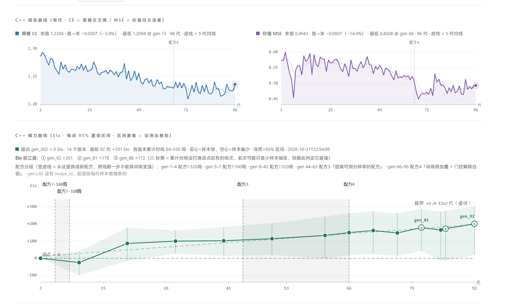

# Flashone — 19×19 五子棋的 AlphaZero 复现（C++ / libtorch）

一个从零训练的 19 路无禁手五子棋引擎：自我对弈 + PUCT 搜索 + 门控评估 + 边库 Elo，
训练与推理全部是 C++（张量运算走 libtorch），配套一个 Python 实时看板。

> **English**: A from-scratch AlphaZero-style engine for **19×19 freestyle gomoku**,
> written in C++ on top of libtorch, with self-play, gated evaluation and an
> append-only Elo edge store. Most open gomoku engines target 15×15 — this one is 19×19.

---

## 成绩（可复现，不是自评）

| 指标 | 数值 |
|---|---|
| 训练跨度 | 90 代（`gen_002` → `gen_092`） |
| 棋力增长 | **+200 Elo**，约 **+2.2 Elo/代** |
| 单代耗时 | 约 8.3 分钟（自对弈 320 局 / 600 模拟 + 训练 800 步 + 门控 60 局） |
| 网络规模 | 6 残差块 × 128 通道，**1.82 M 参数** |
| 硬件 | NVIDIA GeForce RTX 5070 Ti Laptop（专用 11.7 GB） |

Elo 不是拟合出来的曲线：每一段都来自**同一对模型的直接对打**，边库存边、全局
Bradley-Terry 重拟合，锚点固定为 `gen_002 = 0`。原始数据在 Release 里
（`elo_edges.jsonl` / `elo.json` / `train_log.jsonl`），可以自己重新拟合。



<sub>看板截图（19×19 · 配方 4 · 2026-11-01 · 最新已评代 `gen_092`）：上排是策略交叉熵与价值 MSE 的逐代曲线，
下排是 Elo 曲线——色带是 95% 区间，虚线是最小二乘趋势（+2.0 Elo/代），
竖直虚线标出配方切换的位置。曲线上的小锯齿是采样噪声，150 局的分辨率约 ±28 Elo。
图是当时的状态快照，后续代数不会自动更新。</sub>

## 为什么是 19×19

开源五子棋引擎几乎清一色 15×15（Gomocup 生态）。19 路意味着**没有现成的对手和基准**，
但也意味着更接近"棋盘足够大到不能只靠局部死算"的形态：先手优势更强、转换更多、
更需要位置判断而不只是战术深度。这个项目的取舍就是往这个方向走的。

## 结构

```
C++/  (训练与引擎)                 PYTHON/  (看板与对弈)
 ├─ src/ 规则 · MCTS · VCF          ├─ serve_dashboard.py   实时看板 + 训练控制
 ├─ src/net_torch   (libtorch)      ├─ web_play.py          对弈页（人机 / 机机）
 ├─ src/selfplay · trainer          └─ watch_progress.ps1   长卡片 + 曲线渲染
 ├─ src/gate        (Wilson 门控)
 ├─ src/elo_store · elo_run         docs/
 ├─ tools/convert_ckpt.py           ├─ DEVLOG.md   开发日志（含踩坑与实测数据）
 └─ tests/  8 个测试程序，1.4 万项检查   └─ WEIGHTS.md  权重沿革（Python V1–V4 → 主线）
```

关键设计（都在 `docs/DEVLOG.md` 里有实测依据）：

- **门控黑白各半 + 配对开局**：同一开局下双方各执一次黑，消掉先手偏差。
- **边库 Elo**：对局边只追加、同对累加，`elo.json` 永远是**全量重拟合**的结果，
  不存在"分段拟合 + 平移拼接"那种自相矛盾。
- **采纳驱动测量**：门控一采纳，就补打"本代 vs 上一个被测量代"150 局，让曲线上的
  每一段都是直接测量。
- **VCF 静态搜索**（默认关闭，实测中性）：根节点先做强制取胜判定，命中就不花 GPU。

## 快速开始

前置：MSVC 2022 BuildTools、CMake 4.x、Ninja、Python 3.13 且 `pip install torch`。

```bat
cd C++
build.bat
build\gk.exe play --net ..\gen_092.bin --sims 600
```

训练一代（不指定 `--net` 时从随机权重开始）：

```bat
build\gk.exe loop --dir model/run_v2 --gens 10 --games 320 --sims 600 ^
  --min-steps 800 --eval-games 60 --eval-every 2 --gate-threshold 0.52 ^
  --opening-plies 2 --recipe 4 --nice
```

完整的构建细节、命令行开关、测试清单见 [`C++/README.md`](C++/README.md)。

## 权重

不在仓库里（每个 7 MB，仓库只放代码）。请到 **Releases** 下载：

- `gen_092.bin` — 当前最强，对应曲线 `+200 Elo`
- `gen_002.bin` — 起点基线，用来对齐刻度

## 已知不足

老实写在前面，比藏起来有用：

- **白方偏弱**：门控里执黑 26/30、执白仅 7/30。自我对弈分布天然偏向先手取胜，
  防守样本少。
- **近期门控贴平**：88–96 代五次门控都停在 0.483，还没分清是学习率退火压死
  还是容量到顶（lr 已从 3e-4 退到 1.17e-4）。
- **没有外部标尺**：所有 Elo 都挂在 `gen_002` 上，换成人类段位或与其他引擎对比
  都需要外部基准局。
- **19 路没有对手生态**，想横向比较得先把棋盘改成 15 路（网络是全卷积 + 全局池化，
  权重与尺寸无关，可以直接迁移后微调）。

## 许可证

**GPL-3.0**。VCF 搜索的思路来自 [Rapfi](https://github.com/dhbloo/rapfi)（同为 GPL-3.0），
感谢作者。除该模块外，其余代码为原创；Rapfi 源码**不随本仓库分发**。

## 致谢

- AlphaZero 的搜索与训练范式（Silver et al. 2017）
- Rapfi 在 VCF 与强制着法处理上的公开实现
- libtorch / PyTorch
