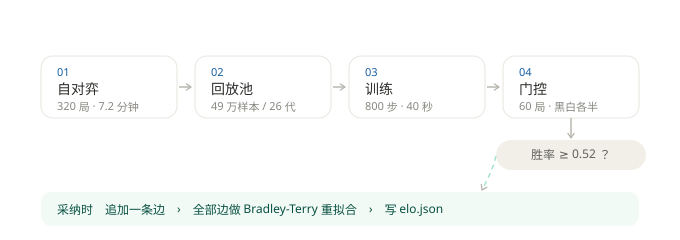
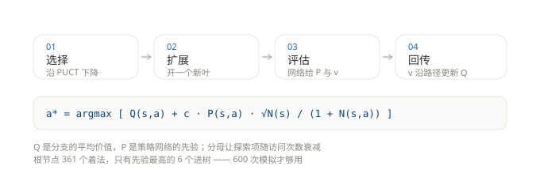
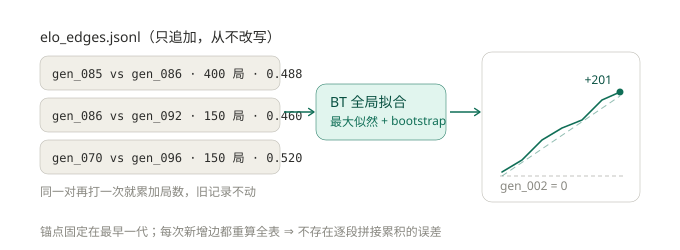

# 算法原理（三张图）

代码是最终的说明，但先看这三张图能少走很多弯路。每张图下面都写了"哪里最容易看错"。

## 1. 一代训练是这么转的



一代的四个阶段：**自对弈 320 局 → 样本进回放池 → 训练 800 步 → 门控 60 局**。
门控只是二元的"过 / 不过"，它不是用来量进步的（60 局的分辨率约 ±13pp，换算成 Elo 约 ±100），
它的唯一职责是**防止 `best.bin` 被崩坏的权重污染**。

绿色的那一段（边库 → 拟合 → `elo.json`）**只在门控采纳时触发**。所以：

| 情况 | 耗时 |
|---|---|
| 被拒的代 | 约 8.3 分钟（自对弈 7.2 + 训练 0.6 + 门控摊薄 0.5） |
| 采纳的代 | 约 12 分钟（多一次 150 局的 Elo 补打） |

**容易看错的地方**：README 里那个"8.3 分钟/代"是平均数。自对弈占了 83% 的时间，训练只占 8%
——这也是为什么"加训练步数"这种改动很便宜（+6% 时间），而"加网络宽度"很贵（自对弈时间翻倍）。

## 2. 搜索：MCTS + PUCT



MCTS 是骨架（选择 / 扩展 / 评估 / 回传），**PUCT 只决定"选择"这一步按什么规则下降**。
与经典 UCT 的差别就在探索项多乘了一个策略网络的先验 `P`：

```
UCT  :  Q + c · √(ln N(s) / N(s,a))
PUCT :  Q + c · P(s,a) · √N(s) / (1 + N(s,a))
```

这个差别在 19 路上是决定性的：根节点有 **361 个合法着法**，600 次模拟平均下来每个着法
只能分到 1.66 次访问——UCT 连"这个点好不好"都问不出来。而 PUCT 第一次模拟就会去打
先验最高的那几个点。

**容易看错的地方**：`--max-children 6` 不是"只看 6 个候选"，而是"只有 6 个能进树"。
剩下的 355 个在扩展阶段就被裁掉了，它们的先验没有被丢弃，只是不参与搜索。

## 3. 测量：边库 + 全局拟合



Elo 曲线不是"每代加一点"累加出来的，也不是"分段拟合再平移拼接"。做法是：

1. 每次测量只往 `elo_edges.jsonl` **追加**一条边：`(a, b, 局数, a 的得分)`；
2. 用**全部边**重新做一次 Bradley-Terry 最大似然拟合，锚点固定为最早一代；
3. 输出 `elo.json`，包含每个版本的点估计与 95% 区间（bootstrap）。

这样做的好处是**每一段都是同一对模型的直接对打**，不存在"链式推算 + 分段平移"那种
累积误差——旧做法正是因为每接一段就累加一次误差，才会出现"曲线说 gen_075 比 gen_065
低 100 Elo，而 400 局定点对打是高 109.5"这种自相矛盾。

**容易看错的地方**：新增一条边会让**老数据点也微调**（比如 `gen_085` 从 198 变成 168）。
那不是棋力倒退，而是新证据把整把尺子重新分摊了一遍。**同一张图前后两次读到的同一个点
不一样，是正常的。**

## 四个数字决定你能读出什么

| 每边局数 | 分辨率 | 能判断什么 |
|---|---|---|
| 150 局 | ±28 Elo | 抓配方崩坏（−50 以上） |
| 400 局 | ±17 Elo | 正式结论的下限 |
| 600 局 | ±14 Elo | 对外发布用 |

小于 ±17 的差异在当前设定下**测不出来**，别拿它做决策。
