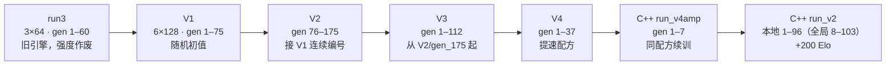

# 权重版本沿革（Python V1–V4 → C++ 主线）

这个项目的权重不是"一次训练跑出来的"，而是一条**接力链**：每换一次网络规模、起点或关键配方，
就开一条新训练线，从上一段最强的权重接过来继续。读懂这条链，才能理解 `run_v2` 那个
「+200 Elo」是相对什么说的。

## 一览

| 版本 | 时间 | 网络 | 起点 | 这一步想干什么 | 结局 |
|---|---|---|---|---|---|
| `run1` / `run2` | 10-10 | 3×64 | 随机 | 最早的原型 | run2 有已知 bug，日志单独存档 |
| **`run3`** | 10-10 | 3×64 | 随机 | 第一个能跑完的长跑（60 代） | 旧引擎，**强度结论全部作废** |
| **V1** | 10-11 | **6×128**（182 万参数） | 随机 `seed=12345` | 只把网络放大 7.4×，其余不动，做**规模对照** | 跑到 gen 75 |
| **V2** | 10-11~12 | 6×128 | 接 V1，编号从 **76** 起 | 接着 V1 继续练，保持全局唯一编号 | 跑到 gen 175 |
| **V3** | 10-12~13 | 6×128 | `V2/gen_175.pt` | 换引擎/重训，产出当时的 champion | gen 112，champion = **gen_110** |
| **V4** | 10-13~15 | 6×128 | 接 V3 末期 | 试**提速配方**（160 局/代、400 模拟、320 步、lr 1e-3） | gen 37，后在 C++ 侧被判无效 |
| `run_v4amp`（C++） | 10-25 | 6×128 | `V4/best.pt` | 把 V4 配方搬到 C++ 验证 | 7 代无进步，弃 |
| **`run_v2`（C++，主线）** | 10-25 起 | 6×128 | `run_v4amp/gen_007.bin`，`gen_offset=7` | 回到 320 局/600 模拟/800 步重训 | 本地 96 代，**+200 Elo** |

## 每个版本具体在干什么

### run3 —— 被作废的第一条基线
3×64（24.8 万参数）、60 代。跑完才发现搜索/规则代码改过，**引擎指纹变了**，
所以它的强度数字不能和新引擎的数字混用。详见 `PYTHON/checkpoints/ENGINE_CHANGE_NOTICE.md`。

### V1 —— 只改网络规模的对照实验
第一次把骨干从 3 块 64 通道放大到 **6 块 128 通道**（182 万参数，7.4×）。
特意用**随机初值**而不是接着 run3 的权重，因为要回答的是"同起点、只变规模，能强多少"。
配方：40 局/代、400 模拟、1200 步、`--mcts-batch 16`（放大到 32/64 实测掉 150–240 Elo）。
跑到 gen 75。

### V2 —— 接力长跑
从 V1 的末端接着练，编号**从 76 起**（因为 run3 已占 1–60，V1 占 1–75，这样全局唯一）。
跑到 **gen 175**，是 Python 时代代数最多的一段。`V2/gen_150.pt` 长期作为对弈页的回落权重。

### V3 —— 换引擎后的重训 + champion
从 `V2/gen_175.pt` 起（记录在 `V3/INIT.json` 的 `weights_from`），跑到 gen 112。
这一代的 **`gen_110` 是当时的 champion**，`gen_30` 曾被写死为对弈页的 `DEFAULT_MODEL`。
注意：V3 的编号又从 1 开始，所以 **`V1/gen_30` 和 `V3/gen_30` 是两个完全不同的模型**。

### V4 —— 想提速，但没成功
从 V3 末期接着练，把配方换成「**每代少下、多来几代**」：160 局/代、400 模拟、320 训练步、lr 1e-3、fresh 0.7，
目标是压短单代时间。Python 侧跑到 gen 37；C++ 侧用同一配方续了 7 代（`run_v4amp`），
结果 **gen1 vs gen7 = 0.550、两次门控 7/20 被拒、mse 0.318→0.411** ——判定无效。
这条负结果直接决定了主线回到「320 局/600 模拟/800 步」。

### run_v2 —— 现在这条线
从 `run_v4amp/gen_007.bin` 起步，`gen_offset = 7`（所以本地 `gen_083` 是项目第 90 代）。
配方沿革：1–4 代配方 1 → 5–7 代那次事故配方 → 8–43 配方 1 → 44–65 配方 3 → 66 起配方 4。
到 2026-10-31 本地跑到 96 代，相对 `gen_002` **+200 Elo**。

## 引用这些权重时的六个陷阱

1. **同名不是同一个模型。** `V1/gen_15`（6×128）和 `run3/gen_15`（3×64）毫无关系；
   `V2/gen_150` 和 `V1/gen_75` 也不同。**判据是目录，不是文件名。**
2. **编号规则中途失效。** run3 1–60、V1 1–75、V2 76–175 是连续的；但 **V3、V4 又各自从 1 开始**。
   所以"gen_30"这种说法必须带版本号，否则无法定位。
3. **跨引擎指纹的数字不可比。** 旧口径 `aabfbd47`（只哈希 `mcts.py`），
   新口径 `44ecc18b`（含 `heuristics.py`、`gomoku_env.py`）。run3 的数字属于旧口径。
4. **`V4/best.pt` ≠ `V4/gen_37.pt`。** 两者 md5 不同，且 `best.pt` 时间戳更早（10-13 vs 10-15）。
   `run_v4amp/run.json` 写的是 `init_from = V4/best.pt`，而 `C++/README.md §6.1` 记的是
   "从 V4 gen_37 起训 7 代" —— **两处不一致，引用时以 `run.json` 为准并注明存疑**。
5. **`PYTHON/models/V1` 是个坏软链接。** 它指向 `<上一级>/checkpoints/pilot/big`，
   少了中间的 `PYTHON/`，在本机已经点不开。真实路径是 `PYTHON/checkpoints/pilot/big`。
6. **权重不在仓库里。** `.gitignore` 排除了 `models/`、`checkpoints/`。要复现得自己训练，
   或用 `C++/tools/convert_ckpt.py` 把 `.pt` 转成 C++ 的 `.bin`（GKAZ1 格式），
   转换后 96 个张量应逐值相同。

## 训练量总账（局数与耗时）

数据来源：Python 侧取 `models/<版本>/train_log.jsonl` 的 `n_games` 求和与首末 `timestamp`；
C++ 侧取 `model/<run>/train_log.jsonl` 的 `games` 与 `selfplay_s / train_s`。

| 版本 | 代数 | 每代局数 | 总局数 | 实际耗时 | 折算 |
|---|---|---|---|---|---|
| `run3`（3×64） | 60 | 40 | 2,400 | **6 小时 37 分** | 364 局/小时 |
| **V1**（6×128） | 75 | 40 | 3,000 | **13 小时 40 分** | 219 局/小时 |
| **V2** | 100 | 80 | 8,000 | **20 小时 34 分** | 389 局/小时 |
| **V3** | 112 | 160 | 17,920 | **45 小时 54 分** | 390 局/小时 |
| **V4** | 37 | 160 | 5,920 | **42 小时 19 分** ⚠ | 140 局/小时 |
| `run_v4amp`（C++） | 7 | 160 | 1,120 | 0.3 小时（自对弈+训练） | — |
| **`run_v2`（C++ 主线）** | 96 | 320 | **30,240** | **11.9 小时** | 2,540 局/小时 |

合计约 **68,600 局**。

几点必须说明，否则数字会被误读：

- **V1 是最慢的一段**（219 局/小时）：6×128 的第一次长跑，当时 `--n-sim 400` 且 8 worker，
  每局推理成本还没优化。V1 之前是 3×64，快得多。
- **V3 与 V4 的墙钟重叠**（V4 从 10-13 21:22 起，V3 到 10-14 14:01 才结束），两条线
  共用一块 GPU，所以 V4 的 42 小时里有相当一部分是在等 V3 —— 它的「140 局/小时」
  不能当作 V4 本身的速度。
- **`run_v2` 的 11.9 小时是净计算时间**（自对弈 9.9 + 训练 0.5 + 门控 1.5），
  不含中途停机、改代码、重启；它的墙钟跨度是 10-25 → 11-01。
  另有 **Elo 测量 1,410 局 ≈ 0.7 小时**，单独计入，不属于训练。
- **折算局/小时只用于横向感受量级**，不同代数的 `n_sim` 不同（V1–V3 是 400，V4 与 C++ 是 600），
  同样的"局"在这个项目里不是同样的算力。

## 现存权重清单

| 版本 | 位置 | 保留的文件 |
|---|---|---|
| V1 | `PYTHON/checkpoints/pilot/big/` | `gen_1..75.pt` + `best.pt` + `resume.pt`（77 个） |
| V2 | `PYTHON/models/V2/` | `gen_150.pt`、`gen_175.pt`、`best.pt`、`resume.pt` |
| V3 | `PYTHON/models/V3/` | `gen_30.pt`、`gen_110.pt`（champion）、`best.pt`、`resume.pt` |
| V4 | `PYTHON/models/V4/` | `gen_37.pt`、`best.pt`、`resume.pt` |
| C++ 主线 | `C++/model/run_v2/` | `gen_001..096.bin` + `best.bin`（= gen_092） |

`best.bin` / `best.pt` 是**门控通过后才更新**的权重，内容不一定等于目录里代数最大的那个文件
（例如 `run_v2/best.bin` 的 md5 等于 `gen_092.bin`，而目录里已有 `gen_096.bin`）。
判断"当前最强"用 md5 对比，别信文件时间戳。
